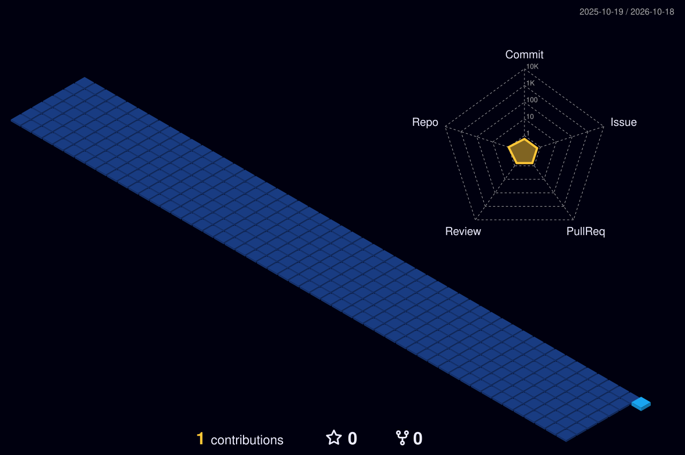

  

  

## Projects

| Project | What it is | Stack |
|:---|:---|:---|
| **Freedom** | My personal OS: 73 apps for money, health and home, on one shared notes system | `Cloudflare` `D1` `Claude` |
| [**Echoes of Idols**](https://echoesofidols.com) | My 3D printing business. Original designs, sold as prints and STL files | `Bambu Lab` `Etsy API` `Automation` |
| [**Photocard Builder**](https://photocard.echoesofidols.com) | Design a 3D-printable photocard holder in the browser and export a multi-colour 3MF | `Cloudflare Pages` `D1` `R2` |
| **EchoesCAD** | In-browser parametric CAD for product models | `Three.js` `Vite` `Hono` |

 

## Contributions

  

